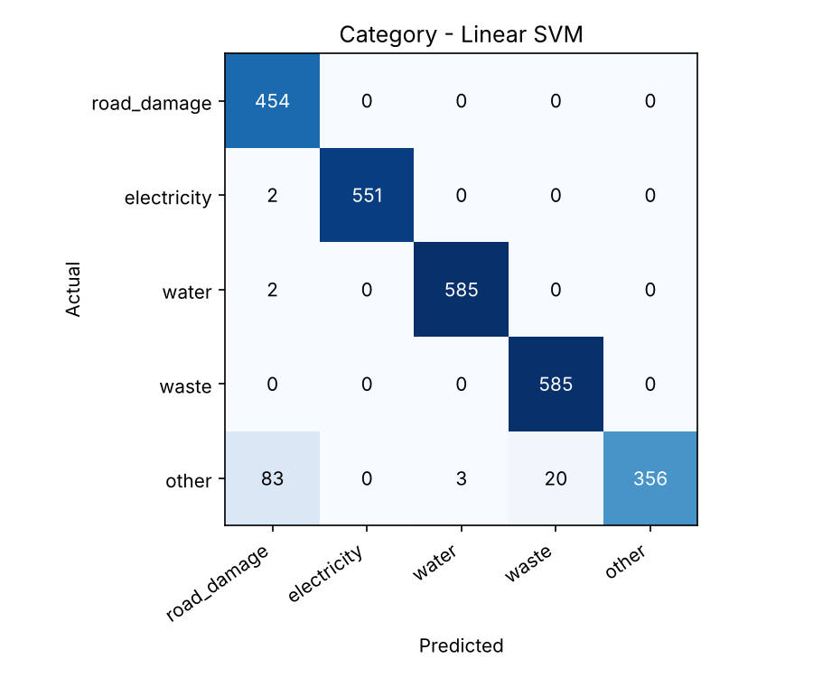
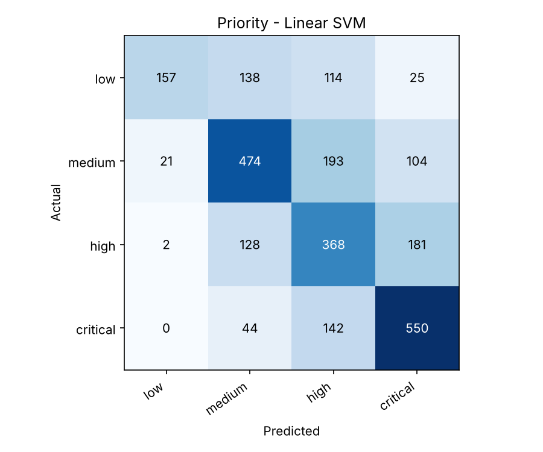

# AISMP model evaluation results

Dataset: 18600 complaints (EN / FR / AR / Arabizi), 151 sentence templates. Train 12805 / test 5795; the test set contains only templates unseen in training.

## Language detection

Rule-based detector accuracy: **0.9874** (per language: {'en': 1.0, 'fr': 1.0, 'ar': 1.0, 'arabizi': 0.956})

## Category classification

| model | cv_f1 | accuracy | precision | recall | f1 | f1_en | f1_fr | f1_ar | f1_arabizi | acc_arabizi_real |
|---|---|---|---|---|---|---|---|---|---|---|
| Keyword baseline | - | 0.7213 | 0.7759 | 0.7235 | 0.7247 | 0.7374 | 0.7217 | 0.7313 | 0.7035 | 0.6705 |
| Naive Bayes | 0.7941 | 0.9016 | 0.8927 | 0.9178 | 0.9005 | 0.8888 | 0.9024 | 0.8809 | 0.9233 | 0.9318 |
| Linear SVM | 0.8587 | 0.9467 | 0.9419 | 0.9557 | 0.9467 | 0.9718 | 0.9683 | 0.8918 | 0.958 | 0.8977 |
| Logistic Regression | 0.8351 | 0.9353 | 0.9269 | 0.9461 | 0.9336 | 0.9388 | 0.9508 | 0.8985 | 0.9473 | 0.9091 |

Selected (best cross-validated macro F1): **Linear SVM**

acc_arabizi_real = accuracy on data/arabizi_realistic.csv: hand-written Arabizi complaints (free spelling, French/English words mixed in), never used for training.

Deployed model on that set: **0.8977**. Misclassified:

| text | expected | predicted |
|---|---|---|
| el sharit el ma2tou3 m3alla2 3al balcon taba3na w el wled bylemsouh | electricity | other |
| sa7eb el moteur 2ate3 el eshtirak 3an kel el binaye bala sabab | electricity | noise |
| el poubellet tayfin w el kleb 3am tfallesh el akyes | waste | stray_animals |
| el chantier 3am yebda 5 el sob7 w bi da22o 7ad shebbekna | noise | illegal_construction |
| fi dekkene bt7ot speaker 3al tari2 w bt3alle el sot, msh ma32oul | noise | road_damage |
| sakkaro el darj el 3am w 3emlouh parking ilon, mamnou3 | illegal_construction | parking |
| el ma7allet 7atin ghradon 3al rasif, ma fina nemshe | parking | road_damage |
| sakkaro el madkhal taba3 el binaye b sayarton, w ma bi redo | parking | illegal_construction |
| el kleb bitlo7o el motosiklet bel leil, 5atar | stray_animals | noise |

## Priority prediction

| model | cv_f1 | accuracy | precision | recall | f1 | within_one_level | critical_recall |
|---|---|---|---|---|---|---|---|
| Rule baseline | - | 0.2825 | 0.3461 | 0.3031 | 0.2388 | 0.7424 | 0.0509 |
| Logistic Regression | 0.5437 | 0.653 | 0.6545 | 0.6633 | 0.6584 | 0.9458 | 0.7112 |
| Linear SVM | 0.5401 | 0.6443 | 0.6571 | 0.6458 | 0.6483 | 0.9484 | 0.7121 |
| Random Forest | 0.5325 | 0.6342 | 0.6526 | 0.6171 | 0.6296 | 0.9379 | 0.5644 |

Selected: **Logistic Regression**. End-to-end (using the predicted category): F1 0.659, accuracy 0.6545, within one level 0.9486.

Metrics are macro-averaged. cv_f1 = mean macro F1 over 5-fold GroupKFold on the training set.
